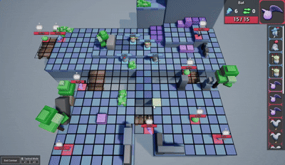

# Turnara

*Working title.*

A tactical 3D RPG inspired by **Dofus**: grid-based, turn-based combat with
roguelike progression layered on top. The goal is that every run hands you a new
map, a new set of enemies, and a reason to change how you fight.

I built this prototype by following tutorials, mainly the Unreal Engine series by
[Alex Quevillon](https://www.youtube.com/@AlexQuevillonEn).

| | |
| --- | --- |
| **Engine** | Unreal Engine 5.6 |
| **Languages** | C++ for core systems, Blueprints for the gameplay layer |
| **Status** | Prototype - combat and grid systems playable, progression not started |

## Gameplay

Grid combat, unit actions and camera control, captured 30 October 2025.
The clip above is a reduced GIF; the
[full-quality capture](media/gameplay-2025-10-30.mp4) is in `media/` (MP4, 32 MB).

## Controls

| Input | Action |
| --- | --- |
| Left and right mouse button | Every player action - move, attack, cast |
| Mouse wheel | Zoom |
| `W` `A` `S` `D` | Pan the camera |
| `Q` `E` | Rotate the camera |

The whole action set is bound to two mouse buttons on purpose: the tactical
decision should be *which tile*, not which key.

## What works

- Top-down camera movement
- Turn-based tactical combat
- Dynamic grid - square, hexagonal and triangular
- Grid-based pathfinding
- Basic tactical AI
- Overworld navigation
- Player action system driven entirely by left and right click
- In-game debug menu for testing
- Worked examples of several unit types, spells, AI behaviours and levels

## What's next

The systems that turn a combat prototype into a roguelike:

- Random map generation
- Random enemy generation
- Level and experience system
- Character class system
- Equipment system
- Roguelike run structure - endless levels

## Concept

Turnara blends grid-based tactical combat with roguelike replayability. A run is
a sequence of fights across generated maps, and the interesting choice is not
which build you picked at the start but how you adapt the one you have to the
board in front of you.
